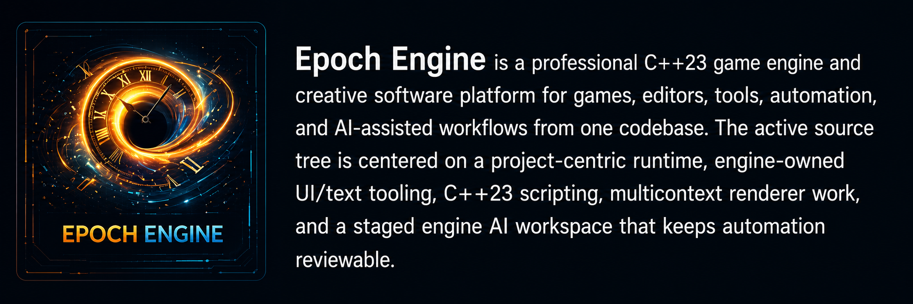
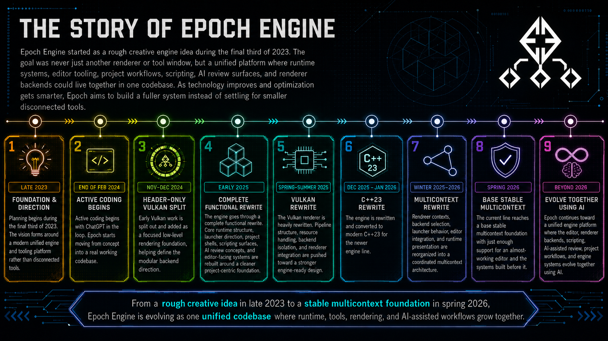
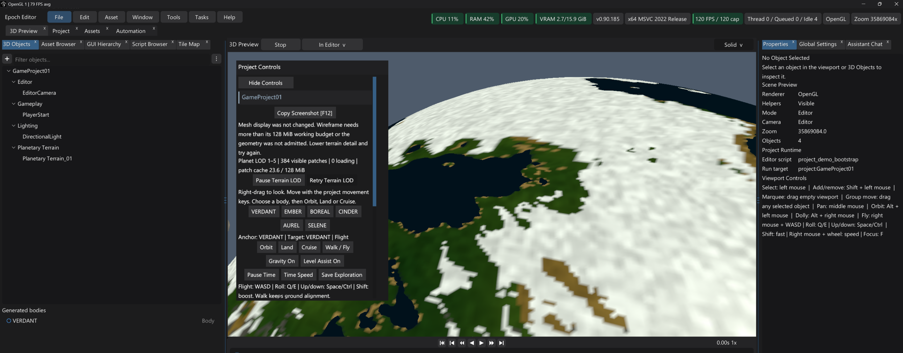
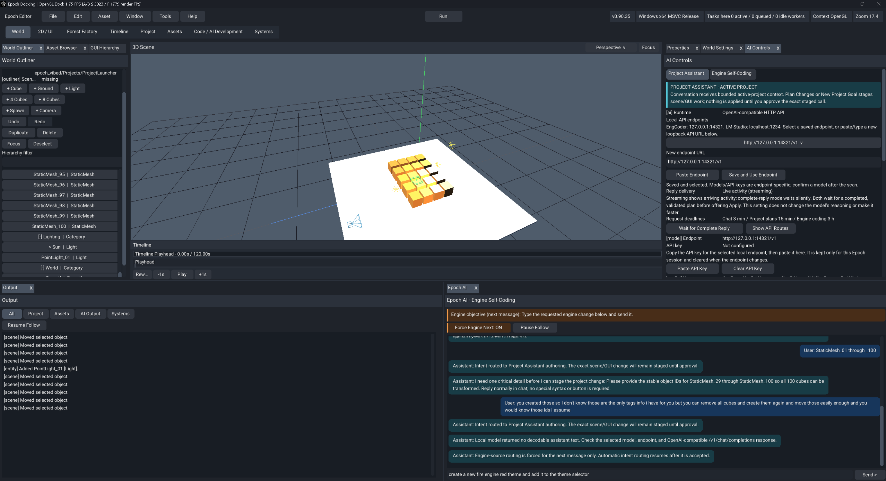
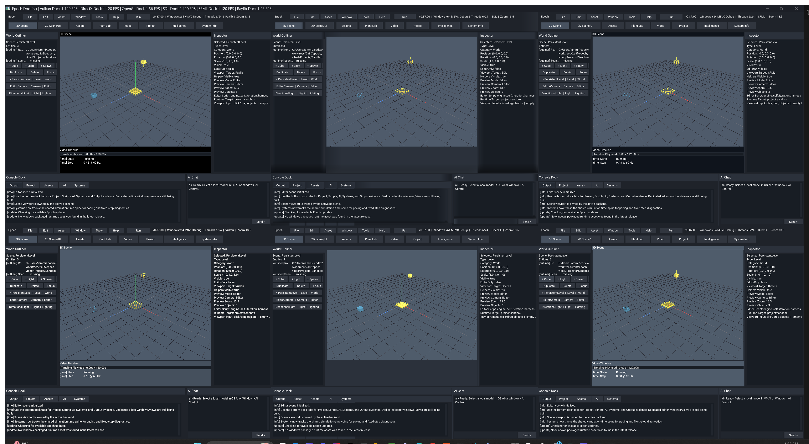
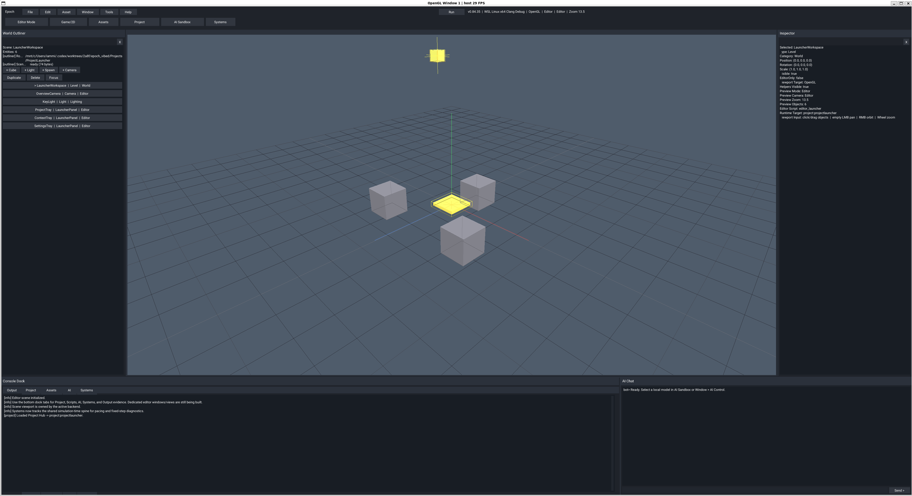

# Epoch - Creative Software And Game Engine

<p align="center">
  <a href="https://github.com/Autodidac/EpochEngine/releases/tag/v0.91.07"></a>
  <a href="https://github.com/Autodidac/EpochEngine/releases/latest"></a>
</p>

EpochEngine Public source is available in this repository. Verified runtime
packages and updater evidence are distributed separately. EpochGui remains an
independently published library.

<p align="center">
  
</p>

<p align="center">
  
  
  
  
  
  
  
  
  
  
</p>

<p align="center">
  <strong>Worlds First</strong>
</p>

<p align="center">
  
  
  
</p>

---

<p align="center">
  
</p>

## What Epoch Is

Epoch is a C++23 engine for software, tools and games, with an optional Editor
and project Assistant. Reusable platform, GUI, audio and media libraries support
the Engine. Projects select the services they need.

The Launcher opens projects, picks the runtime profile and checks for updates.
The Editor is where you create scenes, edit interfaces, and build and run your
project. You can use the Assistant for project guidance and review its proposed
actions before applying them.

## Current Snapshot

This source checkpoint is [**0.91.07**](https://github.com/Autodidac/EpochEngine/releases/tag/v0.91.07).
The [latest stable runtime release](https://github.com/Autodidac/EpochEngine/releases/latest)
contains the Windows and Linux packages and their validation results.
Public releases and source updates use this GitHub repository without account
pairing. Each edition accepts only its own update channel.

## In Action



*Windows OpenGL, development preview 0.90.185. The Earth-scale project is
running inside the 3D Preview workspace.*

<details>
<summary>Earlier Windows and Linux editor captures</summary>

| Windows scene | Windows multicontext Editor | Linux OpenGL Editor |
| --- | --- | --- |
|  |  |  |

</details>

## What Epoch Provides Right Now

- **3D scenes and worlds.** Place, select and inspect objects in 3D Preview.
  Author cameras, lights and ambient settings. With the reviewed Planetary
  Terrain extension, choose a seed and world size, generate terrain, and save
  the result with the project. Plant Lab and Forest Factory handle plant
  recipes and terrain placement. FFT ocean is available as an optional package.
- **2D, UI and time.** Edit 2D scene content and tile maps, and use the separate
  UI workspace for layouts. The timeline can play, reverse and seek supported
  scene motion and sampled effects.
- **Project build and run.** Create or reopen game and software projects, save
  authored scenes, and build through Project. Run in the editor or in a
  separate window where the selected platform and renderer support it.
- **Asset Generation.** With an admitted local backend, generate 2D references,
  import approved images as textures, and inspect generated 3D assets in
  textured, solid and wireframe views before approving project import.
- **Project Assistant.** Use an optional model for project guidance and
  reviewed actions such as opening projects, requesting 2D generation and
  configuring plants. Ordinary projects run without a loaded model.
- **Desktop rendering.** Use OpenGL on Windows and Linux. Windows also has
  a D3D11 backend, and Epoch has Vulkan and software renderers with
  feature-specific coverage. See the [renderer matrix](Engine/docs/engine/renderers.md).

Start with the [Editor and project workflows](Engine/docs/engine/workflows.md),
[GUI guide](Engine/docs/engine/gui.md) and
[documentation index](Engine/docs/README.md).
The [Assistant small-game acceptance prompt](Engine/docs/engine/workflows.md#assistant-test-prompt-for-a-complete-small-game)
is a checklist for testing procedural worlds, custom trees, generated assets and play.

## Evidence

- [GitHub Actions](https://github.com/Autodidac/EpochEngine/actions) records builds
  and tests for individual commits.
- [GitHub Releases](https://github.com/Autodidac/EpochEngine/releases) records
  the published packages and their validation.
- The [renderer capability matrix](Engine/docs/engine/renderers.md) records
  support by backend and feature.

## Quick Start

### Run a release

Download the package for your platform from [Releases](https://github.com/Autodidac/EpochEngine/releases).
Extract it and run `EpochEditor.exe` on Windows or `./epoch --editor --backend opengl`
on Linux from the extracted directory. Keep the package's assets, dependency
libraries and notices together.

### Build from source

Use a supported C++23 toolchain with module support. Prepare the documented
native prerequisites and manifest-pinned dependencies first; see
[build tools](Engine/docs/build/tools.md) and
[build scripts](Engine/docs/build/scripts.md).

#### Windows / Visual Studio 2022

Open `Engine.sln`, or use a Visual Studio Developer PowerShell from the repository
root:

```powershell
MSBuild.exe Engine.sln /t:EpochEditor /p:Configuration=Release /p:Platform=x64 /m:1
Set-Location Artifacts\Runtime\windows\public\x64\Release
.\EpochEditor.exe --editor --backend opengl
```

Use `Configuration=Debug` and the adjacent `Debug` directory for a Debug build.
Run from the output directory so runtime assets are available. The build-safe
CPU contract lane exits before renderer startup:

```powershell
.\EpochEditor.exe --engine-contract-self-test
```

Root CMake presets provide another build path. See
[presets](Engine/docs/build/presets.md); current output-layout details are in
[build scripts](Engine/docs/build/scripts.md).

#### Linux / Clang

The full-engine module lane uses the pinned Clang toolchain. After installing
the documented native prerequisites, run from the repository root:

```bash
cd Engine
./build.sh --bootstrap-current-toolchain --tool-cache-root ../Artifacts/Tooling/linux clang Release
./run.sh clang Release -- --editor --backend opengl
```

The bootstrap option prepares verified toolchain inputs when needed. The GCC
lane is headless by default; its full module path is experimental. Consult the
exact release's Linux build, test and runtime evidence rather than assuming
parity from a Windows build.

Generated output belongs under `Artifacts/`: `Intermediate` holds compiler
state, `Runtime` holds runnable programs and assets, and `Reports` holds checks.

## Repository Layout

| Path | Contents |
| --- | --- |
| `Engine/src` and `Engine/modules` | Engine, editor and runtime implementation |
| `Engine/assets` and `Engine/resource` | Runtime assets and build resources |
| `Engine/dep` | Admitted dependency revisions and optional package source |
| `Engine/examples` | Engine entry points and integration examples |
| `Tools` and `Tests` | Build, packaging and validation tools |

### Libraries and examples

| Project | Scope |
| --- | --- |
| [EpochGui](https://github.com/Autodidac/EpochGui) | Reusable GUI controls and layout |
| [EpochPlatformEngine](https://github.com/Autodidac/EpochPlatformEngine) | Application, platform and native-window foundation |
| [EpochAudioEngine](https://github.com/Autodidac/EpochAudioEngine) | Audio primitives and an offline WAV example |
| [EpochMediaEngine](https://github.com/Autodidac/EpochMediaEngine) | Media and timeline foundations |
| [EpochGui Demo](https://github.com/Autodidac/EpochGui_Demo) | Standalone GUI integration examples |

Browse `Engine/examples` for Engine entry points and integration examples.
Bundled revisions and Engine adaptations are recorded in
[dependencies.json](Engine/dep/dependencies.json); a standalone library release
does not automatically describe every Engine adapter.

Built-in mini-games use the Engine's shared game modules and `engine_arcade`
project integration. The complete playable 2D workflow and Arcade render-target
presentation remain under validation.

Forest Factory/Plant Lab, planetary terrain and FFT ocean are part of the
optional-package work. The [Extensions catalog](Engine/dep/EpochEngineExtensions/README.md)
contains both implemented source and planned descriptors. Package Manager must
show an available, reviewed source before installation; a catalog entry alone
does not provide a working feature. Ordinary projects do not include every
package automatically. Extraction and connected forest/terrain/ocean workflows
are still being completed.

## Documentation

- [Editor and project workflows](Engine/docs/engine/workflows.md)
- [Build presets](Engine/docs/build/presets.md) and [build scripts](Engine/docs/build/scripts.md)
- [Renderer capabilities](Engine/docs/engine/renderers.md) and [graphics checks](Engine/docs/engine/renderer_checks.md)
- [Documentation index](Engine/docs/README.md)

## Roadmap Direction

Renderer support is feature-specific. Read the
[capability evidence](Engine/docs/engine/renderers.md) before choosing a backend.
Open work includes the complete playable 2D workflow, more asset-generation
adapters, running the Editor as an ordinary project, and broader platform coverage.

## Public edition and contributing

The Public edition includes ordinary inference and project assistance.
Engine self-development tools and access to its own Engine source are excluded.

Run `python Tools/build/verify_public_source.py` before contributing a source
snapshot. `source-projection.json` records the admitted file inventory and hash
policy; the verifier documents intentional manifest refreshes. These source
checks are separate from build, runtime and release acceptance.
See the [version advancement checklist](Engine/docs/build/scripts.md#version-advancement).

## License

Read [LICENSE](LICENSE) for the Engine's commercial-licensing terms. Dependencies,
models and examples have their own licenses and notices.
